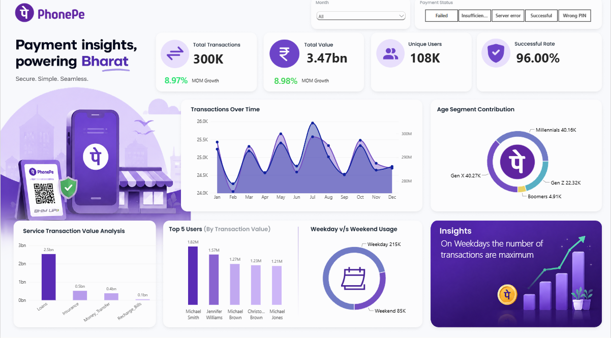

# 📱 PhonePe Transaction Analytics Dashboard | Power BI

> Interactive Power BI dashboard analysing **300K transactions worth ₹3.47bn** across services, age segments, time and weekday/weekend behaviour.




## 🎯 Business Problem
A digital-payments business needs to know: *how is transaction volume trending, which services drive value, which customer segments are most active, when do users transact, and how reliable are payments?* This dashboard answers those questions in a single, interactive view.

## 📊 Headline KPIs (from the dashboard)
| KPI | Value |
|---|---|
| Total Transactions | **300K** (MoM growth **8.97%**) |
| Total Transaction Value | **3.47bn** (MoM growth **8.98%**) |
| Unique Users | **108K** |
| Successful Rate | **96.00%** |

## 🔄 Workflow
1. **Data Collection** – transaction dataset (see [Dataset/README.md](Dataset/README.md))
2. **Data Cleaning** – Excel + Power Query ([docs](Documentation/Data_Cleaning.md))
3. **Data Modeling** – star schema, Date table, Measures table ([docs](Documentation/Data_Modeling.md))
4. **Analysis** – DAX, KPIs, MoM / YoY ([docs](Documentation/DAX_Measures.md))
5. **Visualization** – KPI cards, slicers, charts, custom tooltips
6. **Insights** – findings & recommendations ([docs](Documentation/Business_Insights.md))

## 🧩 Dashboard Features
- Slicers: **Month** and **Payment Status** (Failed, Insufficient balance, Server error, Successful, Wrong PIN)
- KPI cards with MoM growth indicators
- Transactions over time (combo area/line: count + value)
- Age-segment contribution (Gen Z, Millennials, Gen X, Boomers)
- Service-wise transaction value (Loans, Insurance, Money Transfer, Recharge & Bills)
- Top 5 users by transaction value
- Weekday vs Weekend usage
- Insight panel and custom tooltips

## 💡 Key Insights
1. **Loans dominate value** – ~2.5bn of ~3.5bn service value (~71–72%).
2. **Millennials and Gen X lead** – each ~40K users (~37% each); Gen Z ~22K; Boomers ~5K.
3. **Weekdays = 215K vs weekends = 85K transactions** (~72% / 28%), but *per day* usage is almost equal (~43K vs ~42.5K) – the gap is mostly a calendar effect (5 vs 2 days).
4. **Seasonality** – monthly volume ranges ~24K–26K, peaking in July and dipping in February.
5. **Reliability** – 96% success; the remaining 4% split across Failed, Insufficient balance, Server error and Wrong PIN.

Full detail: [Business_Insights.md](Documentation/Business_Insights.md)

## 🛠️ Tech Stack
Microsoft Power BI Desktop · Power Query · DAX · Microsoft Excel

## 📁 Repository Structure
```
├── README.md
├── Dashboard/        # PBIX file (add yours here)
├── Dataset/          # data description / source
├── Screenshots/      # dashboard image
├── Documentation/    # cleaning, modeling, DAX, insights
├── LinkedIn/         # post + project description
└── LICENSE
```

## ▶️ How to Open
1. Download `Dashboard/PhonePe_Dashboard.pbix`
2. Open in Power BI Desktop (latest version)
3. Refresh data if prompted

⭐ If this helped you, please star the repo!
